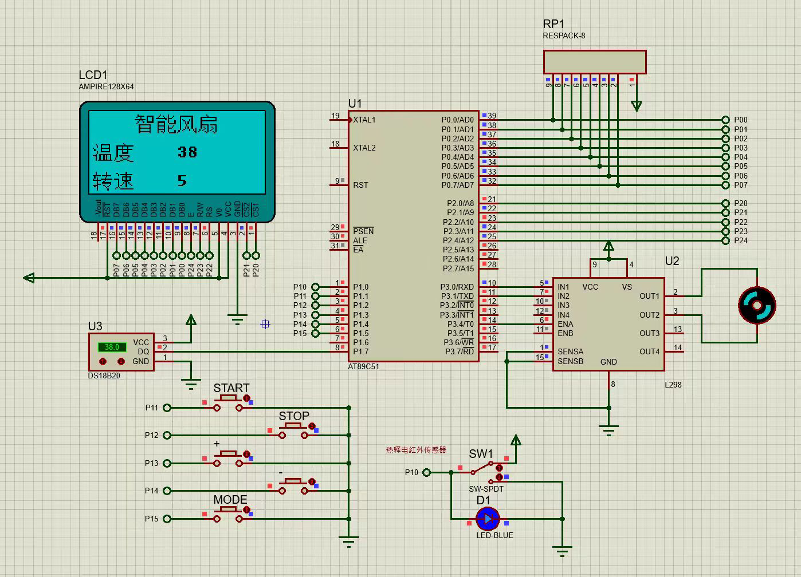
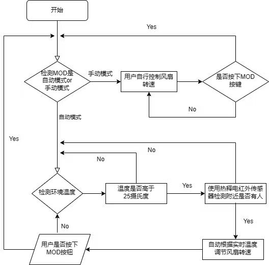

<div align="center">

# 🌡️ 智能温控风扇系统

**基于 AT89C51 的温度闭环 + 人体感应自动调速系统**

[](#)
[](#)
[](#)
[](#)

</div>

<p align="center">
  
  <br>
  <sub>Proteus 仿真运行中：LCD12864 实时显示「智能风扇 / 温度 38℃ / 转速 5 档」</sub>
</p>

---

## 📌 项目简介

系统以 **AT89C51** 为核心，通过 **DS18B20** 采集环境温度，经查表映射为 5 档目标转速，再由 **Timer0 软件 PWM** 输出占空比信号，驱动 **L298** 电机模块完成调速；运行状态实时显示于 **LCD12864** 液晶屏。

在此基础上叠加了两层实用逻辑：

- **人体感应**：热释电红外模块检测到无人时自动停转，省电且避免空转噪音。
- **手动接管**：通过 5 个按键随时切入手动模式，以 20% 步进增减速。

> 设计目标：一个**不用碰开关**的风扇——温度高了它自己转，人走了它自己停。

---

## ⚙️ 核心特性

| 特性 | 实现方式 |
|---|---|
| 🌡️ 温度采集 | DS18B20 单总线协议，SKIP ROM 跳过寻址 |
| 🎚️ 5 档调速 | 温度阈值映射占空比：>35℃→100%、>33℃→80%、>30℃→60%、>28℃→40%、>26℃→20% |
| ⏱️ 软件 PWM | Timer0 每 100μs 中断一次，计数周期 100 → PWM 频率 100Hz |
| 👤 人体感应 | PIR 模块接 P1.0，电平为 0 时强制 `Compare = 0` 停车 |
| 🖥️ 中文显示 | 手写 16×16 汉字字模，直接烧入 `code` 段，无需字库芯片 |
| 🔘 双模式 | MODE 键在自动 / 手动间切换，手动支持 START / STOP / ± 调速 |

---

## 🔌 硬件连接

### 元器件清单

| 器件 | 型号 | 说明 |
|---|---|---|
| 主控 | AT89C51 | 12MHz 晶振 |
| 温度传感器 | DS18B20 | 单总线，1-Wire |
| 液晶显示 | LCD12864 | KS0108 控制器，8 位并行 |
| 电机驱动 | L298 | H 桥，支持正反转与使能调速 |
| 人体感应 | 热释电红外模块 | 高电平检测到人 |
| 输入 | 轻触按键 × 5 | START / STOP / `+` / `-` / MODE |

### 引脚分配

```
LCD12864（KS0108 并行接口）
  P0.0–P0.7  → D0–D7      数据总线
  P2.0       → CS1         左半屏片选
  P2.1       → CS2         右半屏片选
  P2.2       → RS          指令/数据选择
  P2.3       → RW          读/写
  P2.4       → E           使能

DS18B20
  P2.7       → DQ          单总线数据

L298 电机驱动
  P3.0       → IN1         方向控制 1
  P3.1       → IN2         方向控制 2
  P3.4       → ENA         使能（PWM 输入）

按键（低电平有效）
  P1.1 → START   P1.2 → STOP   P1.3 → +   P1.4 → −   P1.5 → MODE

PIR 人体感应
  P1.0       → 检测信号     高电平=有人
```

---

## 🧠 控制逻辑

<p align="center">
  
</p>

主循环每一步都重新采样温度、刷新档位、更新显示，MODE 键可随时跳转到手动控制函数；手动模式下按 MODE 返回自动模式。

### PWM 调速原理

```
Timer0 中断周期：100μs
计数范围：        Counter ∈ [0, 100)  → 一个 PWM 周期 = 10ms（100Hz）

  Counter < Compare  →  IN1 = 0   （导通，电机得电）
  Counter ≥ Compare  →  IN1 = 1   （关断）

  Compare = 20/40/60/80/100  →  对应 1–5 档风速
```

`Compare` 即占空比百分数，既是自动模式的输出，也是手动模式的调节对象——两种模式共用同一套执行链路，避免逻辑分叉。

---

## 🗂️ 工程结构

```
smart-fan-at89c51/
├─ main.c                    主控逻辑：模式切换、温控映射、PWM 中断
├─ DS18B20.c / .h            温度传感器驱动（转换 / 读取暂存器）
├─ Qnewire.c                 单总线底层时序（位级读写）
├─ OneWire.h                 单总线接口声明
├─ LCD12864.c / .h           KS0108 液晶驱动、汉字与数值显示
├─ STARTUP.A51               启动代码
├─ smart_fan.uvproj          Keil uVision 工程
├─ smart_fan.uvopt           调试配置
├─ smart_fan.hex             已编译固件（可直接烧录 / 仿真）
├─ hardware/
│  └─ smart-fan-simulation.DSN   Proteus 仿真工程
└─ docs/
   ├─ simulation.png         仿真运行截图
   └─ flowchart.png          程序流程图
```

---

## 🚀 如何运行

### 方式一：Proteus 直接仿真（推荐，无需硬件）

1. 安装 **Proteus 8** 及以上版本
2. 打开 `hardware/smart-fan-simulation.DSN`
3. 双击 AT89C51，在 **Program File** 处选择 `smart_fan.hex`
4. 点击左下角 ▶ 运行，调节 DS18B20 温度、拨动 PIR 开关观察效果

### 方式二：Keil 重新编译

1. 安装 **Keil uVision4** + C51 编译器
2. 打开 `smart_fan.uvproj`
3. `Project → Rebuild all target files`，生成 `smart_fan.hex`

> 源码按原始路径组织，工程文件中的相对引用无需任何修改即可打开。

---

## 🔍 实现细节

**单总线时序为什么手写？**
`Qnewire.c` 没有用现成库，而是按 DS18B20 手册逐位实现复位脉冲、写 0/1、读时隙。因为 1-Wire 对时序精度要求严格（微秒级），必须结合 12MHz 晶振的指令周期手工校准延时。

**汉字怎么显示？**
没有外挂字库芯片，项目把「智能风扇」「普通」「温度」「转速」等字符预先取模为 16×16 点阵，以 `unsigned char code` 常量的形式存入程序存储器，显示时按字节写入显存。

**为什么用两片 CS？**
KS0108 每片只能驱动 64×64 点阵，128×64 的屏幕由左右两片拼接，操作时需先选中对应半屏再写数据。

---

## 📄 说明

课程设计作品，代码为本人在课程学习期间独立完成。

